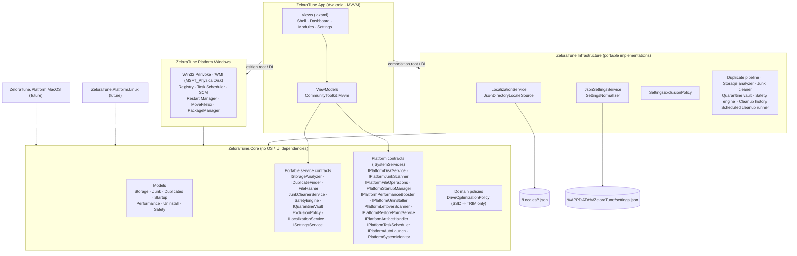

# Zelora Tune with AI — Architecture

Native PC cleanup & optimization suite. **Windows x64/ARM64 first**, Linux and macOS later, using
**.NET 10 (LTS)**, **Avalonia UI** and **MVVM + Clean Architecture**.

The product name is **Zelora Tune with AI** (`ZeloraTune.exe`, data in `%APPDATA%\ZeloraTune`). The projects and
namespaces keep the original `ZeloraTune.*` code name, which never appears in the UI.

## Dependency rule



* **Core** references nothing. It defines the models and every interface. It is AOT and trimming safe.
* **Infrastructure** holds the OS-independent implementations. Duplicate hashing, tree scanning and the
  quarantine vault are portable too, so they live here and not in the platform layer.
* **Platform.*** projects implement only the `IPlatform*` interfaces. The `ISystemServices` facade groups them.
  Adding Linux or macOS means adding one project. Core, Infrastructure and the ViewModels stay unchanged.
* **App** is the only composition root. Views bind to ViewModels, and ViewModels depend only on Core interfaces.

## Solution layout

```
ZeloraTune.slnx
Directory.Build.props            net10.0 · nullable · warnings-as-errors · analyzers (latest-recommended)
.editorconfig
Locales/                         tr-TR (primary / master) · en-US · de-DE · fr-FR · it-IT
src/
  ZeloraTune.Core/
    Common/                      OperationProgress · ItemResult/BatchResult · LocalizedMessage · ArtifactReference · IAppPaths
    Models/                      Storage · FileOperations · Junk · Duplicates · Startup · Performance · Uninstall · Safety
    Platform/                    IPlatform* contracts + ISystemServices facade
    Services/                    portable service contracts · IExclusionPolicy · DriveOptimizationPolicy
    Localization/                ILocalizationService · LanguageInfo
    Settings/                    AppSettings (8 sections) · ISettingsService
    Threading/                   IUiDispatcher
  ZeloraTune.Infrastructure/
    Common/                      DefaultAppPaths
    Localization/                LocalizationService · JsonDirectoryLocaleSource · LocaleJsonParser · LanguageSettingsSynchronizer
    Settings/                    JsonSettingsService · SettingsJsonContext (source-gen) · SettingsNormalizer · SettingsExclusionPolicy
    Safety/                      SafetyEngine · QuarantineVault · FileArtifactHandler
    Storage/ · Junk/ · Duplicates/ StorageAnalyzer · JunkCleanerService · ScheduledCleanupRunner · FileHasher · DuplicateFinder
    History/                     JsonCleanupHistory
    Threading/                   ImmediateUiDispatcher
    DependencyInjection/         AddZeloraTuneInfrastructure()
  ZeloraTune.Platform.Windows/    Interop/ (LibraryImport) · Monitoring/ (CPU/RAM/PDH disk) · WindowsPlatformInfo
                                 Storage/ · Junk/ · Files/ · Startup/ (startup manager, logon + cleanup tasks)
                                 Booster/ (incl. game-mode apps) · Uninstall/ · Safety/ (artifact handlers, restore points, ProtectedDirectory)
                                 Setup/ (self-installer, shortcuts) · Common/ (UnelevatedProcess, NativeDialogs, …)
  ZeloraTune.App/                 Avalonia 12 desktop shell
    app.manifest                 requireAdministrator · PerMonitorV2 DPI · long paths
    Program.cs                   single instance → DI → load settings → init language → start Avalonia
    Composition/                 AppServices (the only composition root)
    Hosting/                     SecureStartup · AppContent · BoostModeController · ThemeController · AutoLaunchCoordinator
                                 AutomationCoordinator · StartupMaintenance
                                 TrayController · SingleInstanceGuard
    Localization/                {l:Loc Key} markup extension (live re-localization)
    Controls/                    RadialGauge · Sparkline · Treemap (custom-rendered)
    ViewModels/                  MainWindow · Dashboard · Storage · Junk · Duplicates · Performance · Uninstaller · Safety · Settings
    Views/                       one view per page · Dialogs/
    Themes/                      Colors.axaml (Dark/Light tokens) · Styles.axaml
tests/
  ZeloraTune.Tests/               xUnit: localization, settings, safety, every engine (sandbox folders + throwaway HKCU keys only)
  ZeloraTune.App.Tests/           xUnit v3 + Avalonia.Headless: real Skia frames, every page end to end, language switch, theme
LICENSE · NOTICE · THIRD-PARTY-NOTICES.txt
```

## Cross-cutting conventions

| Concern | Rule |
|---|---|
| Async & cancellation | Every I/O-bound API is `async`, accepts a `CancellationToken`, and reports through `IProgress<OperationProgress>` (a value type, so frequent reports don't allocate). |
| Streaming results | Scanners return `IAsyncEnumerable<T>`, so the UI fills in while the scan is still running. |
| Partial failure | Destructive batch operations never throw for one bad item. They return a `BatchResult` with an `ItemOutcome` for every target. |
| User-facing text | Services return `LocalizedMessage` (a key plus arguments), never rendered strings. The UI renders it again after a language switch. |
| Threading | Infrastructure raises `PropertyChanged` and events through `IUiDispatcher`, so bindings never fire on worker threads. |
| Safety | Every module checks `IExclusionPolicy`, which combines the user whitelist with the platform's hard-coded `IPlatformProtectionPolicy`. Registry, uninstall and startup changes go through `ISafetyEngine`, which creates a restore point and quarantines first. |

## Localization (Step 2)

* Locale files are `Locales/{culture}.json`. Nested JSON is flattened to `Section.Key`, and the `_meta` block
  holds the culture, native name, RTL flag and an optional fallback. Keys starting with `_` are translator notes.
* **Turkish is the primary language.** `tr-TR.json` is the master dictionary and the final fallback, so any key that is
  missing from another translation appears in Turkish. On first launch the app follows the OS display language
  when it is one of the five shipped languages, and uses Turkish otherwise.
* The service merges dictionaries in the order **default (tr-TR) ← declared fallback ← target** into one
  `FrozenDictionary` and swaps it in atomically, so lookups need no lock.
* A language switch raises `PropertyChanged("Item[]")`. Every `{Binding [Key]}` refreshes at once and nothing restarts.
* Culture resolution: exact match, then the same language (`de-AT` → `de-DE`), then the default.
* A file in the user's `%APPDATA%\ZeloraTune\Locales` overrides the bundled translation key by key. An optional
  `FileSystemWatcher` reloads translations live.
* Helpers: `Format` (culture-aware; a broken translation never crashes), `Plural` (zero/one/other),
  `FormatBytes` (localized units, about 3 significant digits) and `Render(LocalizedMessage)`.
* Tests check that exactly the five product languages ship, and that each one has exactly the Turkish master's keys
  and the same placeholders. RTL layout is still supported by the engine and checked by a UI test, using a test-only dictionary.

## Settings (Step 2)

* `AppSettings` has 8 sections: General, JunkCleaner, DuplicateFinder, Storage, Booster, Exclusions, Safety and Automation.
* Serialization uses System.Text.Json source generation. Enums are written as names. Comments and trailing commas are allowed.
* **Copy-on-write:** `Current` is an immutable snapshot. `UpdateAsync(mutate)` clones it, applies the change,
  normalizes, persists and publishes, and the updates are serialized.
* `SettingsChanged` reports exactly which sections changed. A no-op update writes nothing.
* **Atomic writes:** the service writes `.tmp`, then calls `File.Replace`, keeping a `.bak`. If replacing fails, it falls back to copy+move (for sync clients that refuse ReplaceFile).
* **Recovery:** a corrupt file is kept as `settings.corrupt-*.json` and the backup is restored. An invalid
  *section* resets only that section. A file from a newer schema is copied aside before it is rewritten.
* The normalizer clamps numeric ranges, resets undefined enums, and puts paths, extensions, registry hives
  and process names in canonical form.

## UI shell (Step 3)

* **Startup order:** single-instance guard → DI → load settings → initialize the language → start Avalonia.
  The first frame is already in the right language and theme, so raw keys never flash.
  The hardware-acceleration setting chooses the renderer here (ANGLE/Skia or software).
* **Live localization:** `{l:Loc Key}` binds to `ILocalizationService.Revision`. Every label switches
  language the moment the setting changes. View-model text re-renders through `LocalizedViewModelBase.OnLanguageChanged`.
  `FlowDirection` follows the language for RTL. The title bar always stays LTR, because Windows keeps its caption buttons on the right.
* **Glass:** the window asks for Mica, then Acrylic, then nothing. The base layer switches between translucent and solid
  depending on what the OS actually granted (`ActualTransparencyLevel`).
* **Motion:** gauge, sidebar and progress transitions and page cross-fades run only while the root carries the `motion`
  class (Settings → Animations).
* **Telemetry:** the dashboard samples only while it is visible. Sampling stops while the window is hidden in the tray.
* **Settings auto-save:** edits are debounced for 400 ms and committed as one atomic update. Reset, import and normalization
  flow back into the cards, except for a card that still has pending edits.
* **Tray:** closing the window hides it (configurable). Sign-out and shutdown are never blocked.
  A second launch brings the running instance to the front.
* **Launch at sign-in:** an elevated Task Scheduler logon task (`HighestAvailable`). UAC silently skips Run-key entries
  for apps that require administrator rights.

## Modules (Step 4)

| Page | Engine | Safety net |
|---|---|---|
| Storage | `StorageAnalyzer` (parallel tree walk, treemap, large files, micro-file clusters) · `WindowsDiskService` (seek-penalty/bus detection, `defrag /L` TRIM, `/D` defrag, WMI fragmentation analysis) | Defrag is never offered for SSDs; non-NTFS/ReFS volumes get no optimization. |
| Junk | `JunkCatalog` + `WindowsJunkScanner` (temp, caches, dumps, update leftovers, per-profile browser data) · `JunkCleanerService` | Saved passwords and bookmarks are never touched unless the user opts in; locked files follow the locked-file policy. |
| Duplicates | Size → partial xxHash64 (head + tail) → full xxHash128 / BLAKE3 / SHA-256 | Hard links are collapsed; at least one copy of every group is always kept. |
| Speed & startup | `WindowsStartupManager` (Run keys, Startup folders, tasks, services; `StartupApproved` flags) · `WindowsPerformanceBooster` (`EmptyWorkingSet`, Game/Work mode service suspension) | Toggles are reversible like Task Manager's; removals are quarantined; a journal restarts suspended services after a crash. |
| Uninstaller | `WindowsUninstaller` (HKLM 32/64 + HKCU + `PackageManager`) · `WindowsLeftoverScanner` | Force removal takes a restore point and quarantines the registration; only high-confidence leftovers are pre-checked; everything removed is quarantined. |
| Backups & restore | `QuarantineVault` · `WindowsRestorePointService` (`SRSetRestorePointW`, WMI `SystemRestore`) | One-click restore of every quarantined item; entries expire after the retention period (purged at startup). |

**Scheduled cleanup.** `AutomationCoordinator` keeps two Task Scheduler tasks (`ZeloraTune\ScheduledCleanup`, and
`ZeloraTune\LowDiskCheck` every 4 hours) in sync with Settings → Automation. They start `ZeloraTune.exe --scheduled-clean`
or `--low-disk-check`, which runs `ScheduledCleanupRunner` headless (no window, no single-instance handoff) and exits.
Unattended runs clean only categories that are both *Safe* and enabled, and record them in the cleanup history shown on the dashboard.

## Distribution: one download, a full installation

The downloaded `ZeloraTune.exe` is self-contained and single-file; the installed copy is a regular multi-file
application folder. `Program.Main` decides the role:

| Start | Role |
|---|---|
| `--scheduled-clean`, `--low-disk-check` | headless cleanup (Task Scheduler), then exit |
| `--uninstall [--quiet]` | uninstaller used by "Apps & features" |
| `--install [--install-dir=…] [--desktop-shortcut]` | silent install for scripted deployment |
| from `%ProgramFiles%\Zelora Tune` | installed app (data in `%APPDATA%\ZeloraTune`) |
| with `ZeloraTune.Data` next to it, or `--portable` | portable app (data next to the exe) |
| anything else (first run of a download) | setup window: install / update / run portable |

The release build (`build/publish.ps1`) publishes the app twice: first as the **install layout**
(`-p:InstallLayout=true`: self-contained, multi-file, with `Locales/` and the license texts), which is zipped, then as
the single executable with that zip embedded (`-p:InstallPayload=…`, resource `Setup/InstallPayload.zip`).
`WindowsInstallation.InstallAsync` unpacks the layout into Program Files (`LayOut`: each file is written next to its
target and moved over it, entries that would land outside the folder are refused, files an earlier version listed in
`install.manifest` but no longer ships are removed — nothing else in the folder is touched), writes the uninstall
registration (HKLM) and creates shortcuts through `IShellLinkW` (source-generated COM). A build without the payload
(development) copies the executable alone.

The portable executable carries translations and license texts as embedded resources that `AppContent` writes once
per version into the protected folder; the installed copy reads them from its own admin-only program folder.

## Security model

The app always runs elevated (`requireAdministrator`). Its rule: **nothing a non-elevated process of the same user
can modify may ever be executed, loaded or trusted with admin rights.**

* **Protected data folder** — `%ProgramData%\ZeloraTune`, created with a protected DACL (SYSTEM + Administrators
  only) and verified at every start: if it exists but is not owned by Administrators/SYSTEM (a squatter), the app
  refuses to start. It holds the quarantine vault (restored with admin rights), the boost journal (decides which
  services and apps are started), temporary Task Scheduler XML and the runtime extraction cache.
* **No DLL planting** — single-file apps unpack native libraries before `Main`, by default into `%TEMP%`. The first
  process therefore only verifies the protected folder and restarts itself with `DOTNET_BUNDLE_EXTRACT_BASE_DIR`
  pointing inside it; only that child loads native code. Content is embedded instead of using
  `IncludeAllContentForSelfExtract`, which would also unpack assemblies into `%TEMP%`.
* **De-elevation** — commands from HKCU uninstall entries and uninstallers in user-writable folders run with the
  desktop shell's token (`CreateProcessWithTokenW`); so do apps reopened after game mode.
* **Prompt-less elevation only for protected binaries** — the scheduled cleanup and launch-at-sign-in tasks run with
  highest privileges, so they are registered only when the executable's folder is admin-only (the installed copy).
* **Link-safe file operations** — deletion never follows junctions; shredding opens the file with
  `FILE_FLAG_OPEN_REPARSE_POINT` and refuses reparse points and hard links on that handle.

## System health

`IPlatformHealthProbe` (Windows: `WindowsHealthProbe`) reads only sources Windows exposes without kernel drivers:
`MSFT_PhysicalDisk` + `MSFT_StorageReliabilityCounter` (S.M.A.R.T.), the Diagnostics-Performance event log via
`wevtutil` (boot durations), CIM hardware classes, ACPI thermal zones, NVIDIA NVML loaded by full path from System32,
`NetworkInterface` counters, Security Center 2 and the registry. Every source is optional. `SystemHealthService`
gathers the inputs in parallel (the junk estimate is a read-only scan, cached for 15 minutes) and `HealthScoring`
turns them into a deterministic score: 100 minus a fixed penalty per issue, each issue carrying the page that fixes it.

## Themes

A theme is a Fluent base variant plus, for the five designed themes, a palette dictionary
(`Themes/Palettes/*.axaml`) that overrides every surface and brand token of `Colors.axaml`. `ThemeController`
merges the palette last, sets the Fluent accent color and the base variant; every brush is a `DynamicResource`, so
all open windows — including the tray menu — recolor in place. `ThemeCatalog` lists the themes with preview colors
for the swatch gallery (Settings, setup screen).

## Tray icon

`NotifyIcon` (Platform.Windows) drives `Shell_NotifyIcon` directly through a hidden callback window; it re-adds the
icon when Explorer restarts. Its right-click opens `TrayMenuWindow`, an app-drawn menu that uses the theme tokens —
the native popup menu could not be themed.

## Game mode

`BoostModeController` owns the single Game/Work session. Game mode (Settings) closes the listed background apps —
WM_CLOSE to their windows first, termination only if ignored — stops non-essential services and trims idle working
sets. Every app (path + original command line) and service is written to the journal *before* it is touched, so
`RecoverInterruptedSessionAsync` restores them after a crash. Ending the session (switch off, app exit) restarts the
services, then reopens the apps with the user's normal rights.

## Registry cleaner and force uninstall

**Protection first.** `IPlatformProtectionPolicy.IsProtectedRegistryKey/Value` (Windows: `RegistryProtection`) is the
registry counterpart of the protected-path policy and is applied by `SettingsExclusionPolicy` — so by every scanner
and by `SafetyEngine` before anything is deleted. Paths are canonicalized (short hive names, `HKCR` → `HKLM\SOFTWARE\Classes`,
`HKU\<SID>` → `HKCU`, `WOW6432Node` dropped). Sealed trees (SYSTEM, SAM, SECURITY, Windows NT, Policies…) allow no
deletion inside; structural keys (hive children, `Software\Microsoft\*`, `…\CurrentVersion\*`, Classes roots, CLSID,
extension keys, system verbs) may not be deleted themselves. Firewall rule values are the single deliberate exception.

**Registry cleaner.** `IPlatformRegistryCleaner` (`WindowsRegistryCleaner`, locations injectable as
`RegistryCleanerLocations`) only reports what `PathProbe` says is *certainly* missing: a "not found" answer from a local
fixed drive. Relative paths, UNC paths, unplugged/removable/network drives, access-denied answers and the WindowsApps
folder are *unknown* and never reported; 32-bit registry data is resolved with 32-bit semantics (`System32` →
`SysWOW64`, `%ProgramFiles%` → `Program Files (x86)`); targets inside the Windows folder are never judged. A file type
is reported only when every one of its commands is broken; a COM class only when none of its servers exists. Fixes go
through `ISafetyEngine` (`SafetyOperation.RegistryCleanup`): restore point, `reg export` backup, delete.

**Force uninstall.** `IPlatformForceUninstaller` (`WindowsForceUninstaller`) combines the leftover scanner (which now also
finds App Paths, file types, context-menu verbs, SharedDLLs/Installer/MuiCache values pointing into the install folder)
with the program's registration, its Windows Installer records (product, features, per-user data, upgrade codes —
product codes are *packed*, see `MsiGuid`), the Store data folder and the processes running from the install folder.
`ForceUninstallViewModel` is a four-step wizard; `ArtifactSet.WithoutNested` drops entries removed with a parent anyway,
and removal is ordered services → tasks → firewall → files → registry. `IPlatformRegistryBrowser` shows a key's
values in the review screens and opens Registry Editor at it.

## Smart cleanup (on-device AI)

`ISmartCleanupService` (Infrastructure: `SmartCleanupService` + `ImageAnalyzer`, SkiaSharp) analyzes pictures and
files entirely on the PC — no model download, no network. Pictures are decoded at a reduced scale; a 64-bit
difference hash over area-averaged cells groups similar shots (union-find, Hamming distance ≤ 8, same aspect ratio),
the variance of the Laplacian measures sharpness, and a weighted score of independent signals (name, folder, screen
resolution, camera EXIF, lossless format, flat-color share) recognizes screenshots. Forgotten files are rule-based:
old installers and archives in downloads, unfinished downloads, "name (1).ext" copies, large unused files and build
outputs of projects untouched for months. Every threshold is a user setting (`SmartCleanupSettings`, clamped by the
normalizer, turned into `SmartScanOptions.From`), and each suggestion shows the rule it matched next to its own age. Cloud-only OneDrive files are never opened (no download is triggered).
The service only *suggests*: the page marks nothing on its own, keeps one picture of every similar group and removes
only after confirmation, always to the Recycle Bin.

## Filtering

Every list the user picks items from shares one engine, `FilterViewModel` (App/ViewModels/Filtering) with its view
`FilterBarView`. A page declares what its list offers in a `FilterSpec` — search, size range, a date filter and its
label, ticked/unticked, chip groups (e.g. reason, risk, hive, confidence; chips in one group are alternatives, groups
combine) and sort fields — describes each item as a `FilterItem` (text, size, date, chip ids, tick state) and calls
`ApplyTo` on every `Changed`, which only touches the visible collection when the result differs (scroll position and
selection survive). Search splits into terms, all of which must match, ignoring case and diacritics both by the UI
culture and culture-neutrally. Select all / none act on the visible items; operations still act on every ticked item
— the registry cleaner's confirmation states how many of those are hidden, and a ticked key that contains an
unticked entry is never deleted.

## Licensing

Zelora Tune with AI is licensed under the **Apache License 2.0** (`LICENSE`), with attribution in `NOTICE`.

* Every C# file starts with an SPDX header. `.editorconfig` (`file_header_template` + IDE0073) fails the build when a
  header is missing or altered.
* `Directory.Build.props` sets `PackageLicenseExpression=Apache-2.0`, plus the copyright and authors metadata.
* `THIRD-PARTY-NOTICES.txt` lists the bundled dependencies. These are Avalonia (incl. DataGrid), SkiaSharp, HarfBuzzSharp,
  CommunityToolkit.Mvvm, Microsoft.Extensions.*, System.IO.Hashing, System.Management, ServiceController and the .NET
  runtime (all MIT), Blake3.NET (BSD-2-Clause), ANGLE (BSD-3-Clause), the Inter font (SIL OFL 1.1) and the
  Windows SDK C#/WinRT projection (Microsoft redistributable).
  The license texts are copied from the restored packages. Regenerate the file when dependencies change.
* The app ships `LICENSE`, `NOTICE` and `THIRD-PARTY-NOTICES.txt` next to the executable. **Settings → About & Licenses**
  displays all of them in the app.
